<h1></h1>

**AI Systems · LLM Agents · Machine Learning · Software Engineering**

Building reliable AI software — from retrieval and agent workflows to evaluation, APIs, and real-world applications.

[Open Source](#open-source) &nbsp;·&nbsp; [Selected Projects](#selected-projects) &nbsp;·&nbsp; [ML Competitions](#machine-learning-competitions) &nbsp;·&nbsp; [Skills](#skills)

  
  
  

---

## About

I'm a developer and researcher interested in the intersection of **AI systems, software engineering, and applied machine learning**. I enjoy building end-to-end prototypes, making model behavior measurable, and improving software through testing and iteration.

- **Education:** Incoming M.S. in Machine Learning & Data Science at **Northwestern University**; undergraduate degrees in Finance from **Shanghai University** and **University of Technology Sydney**.
- **Engineering interests:** LLM agents, retrieval-augmented generation, multimodal search, backend services, and AI infrastructure.
- **Approach:** Build useful systems, understand failure cases, and leave the codebase more reliable than I found it.

## Open Source

### [ByteDance / DeerFlow](https://github.com/bytedance/deer-flow) — Contributor

**[Merged PR #7150](https://github.com/bytedance/deer-flow/pull/7150)** · [View commits](https://github.com/bytedance/deer-flow/pull/7150/commits) · `Python` / `Agents` / `LangGraph` / `Testing`

DeerFlow is ByteDance's open-source long-horizon agent harness for complex, multi-step tasks. My contribution improves the reliability of document outlines consumed by agents.

- **Fixed Markdown heading corruption.** Uploaded headings with separate bold spans, such as `# **Revenue** and **Profit**`, could be incorrectly normalized into `Revenue** and **Profit`.
- **Made parsing boundary-aware.** Updated whole-title bold-marker cleanup to preserve independent bold spans, including mixed Chinese/English headings, across direct Markdown uploads and registered conversion companions.
- **Added regression coverage.** Introduced **19 outline test scenarios** covering nine heading patterns across upload sources, plus a regression for the actual `list_uploaded_files` tool output.
- **Verified the change.** Targeted test suites: **353 passed, 7 skipped**; Ruff lint and formatting checks passed. **4 files changed · +52 / −3 lines.**

> **Merged into `main` on October 20, 2026.** [Review the pull request →](https://github.com/bytedance/deer-flow/pull/7150)

## Selected Projects

| Project | Engineering focus |
| :--- | :--- |
| **[Occupational Fitness Platform](https://github.com/Zicheng-Xie/Occupational-Fitness-Platform)** | Traceable, local-LLM-assisted assessment with source-grounded hybrid RAG, deterministic rules, and FastAPI interfaces. |
| **[Agent-powered Financial Multimodal Report Generator](https://github.com/Zicheng-Xie/Agent-powered-Financial-Multimodal-Report-Generator)** | Automated financial research with data collection, iterative LLM-assisted analysis, charts, and Markdown/Word report generation. |
| **[E-commerce Multimodal Intelligent Content & Retrieval](https://github.com/Zicheng-Xie/E-commerce-Multimodal-Intelligent-Content-and-Retrieval-System)** | Multimodal product search and content-generation project spanning retrieval, fashion understanding, and system design. |

## Machine Learning Competitions

| Competition / Repository | Result | Methods |
| :--- | :--- | :--- |
| [Kaggle · Jane Street Real-Time Market Prediction](https://github.com/Zicheng-Xie/Zicheng_Xie-2025-Kaggle-Jane-Street-Real-Time-Market-Data-Forecasting-Competition-) | **Silver medal · 67 / 3,757** | Time-series features, GBDT, neural networks, ensembles |
| [Kaggle · Jigsaw Agile Community Rules](https://github.com/Zicheng-Xie/2025Kaggle-Jigsaw_Agile-Community-Rules-Classification) | **Bronze medal · 174 / 2,437** | LLM fine-tuning, contrastive embeddings, rank fusion |
| [Kaggle · Real Estate Demand Prediction](https://github.com/Zicheng-Xie/2025Kaggle-Real-Estate-Demand-Prediction) | **95 / 777** | Panel time series, CatBoost, feature engineering |

Also: **[ICBC Cup Financial Technology Innovation Competition](https://github.com/Zicheng-Xie/2023-ICBC_Cup-National-College-Financial-Technology-Creative-Design-Contest)** — Shanghai first prize.

## 🛠️ Skills

<strong>Languages</strong>

  

<code>SQL</code>

<strong>AI &amp; Machine Learning</strong>

  

<code>Transformers</code> &nbsp;·&nbsp; <code>LightGBM</code> &nbsp;·&nbsp; <code>XGBoost</code> &nbsp;·&nbsp; <code>CatBoost</code>

<strong>Agents &amp; Retrieval</strong>

<code>LangChain</code> &nbsp;·&nbsp; <code>LangGraph</code> &nbsp;·&nbsp; <code>RAG</code> &nbsp;·&nbsp; <code>FAISS</code> &nbsp;·&nbsp; <code>Chroma</code> &nbsp;·&nbsp; <code>BM25</code> &nbsp;·&nbsp; <code>Ollama</code> &nbsp;·&nbsp; <code>vLLM</code>

<strong>Engineering &amp; Data</strong>

  

<code>REST APIs</code> &nbsp;·&nbsp; <code>Pytest</code> &nbsp;·&nbsp; <code>Ruff</code> &nbsp;·&nbsp; <code>Pandas</code> &nbsp;·&nbsp; <code>NumPy</code>

<strong>GitHub activity</strong>

  

---

**Interested in collaborating on AI systems, agents, and applied ML?**

[Email](mailto:zichengxie2004@163.com) &nbsp;·&nbsp; [GitHub](https://github.com/Zicheng-Xie) &nbsp;·&nbsp; [DeerFlow PR #7150](https://github.com/bytedance/deer-flow/pull/7150)

Build thoughtfully. Test thoroughly. Keep learning.

